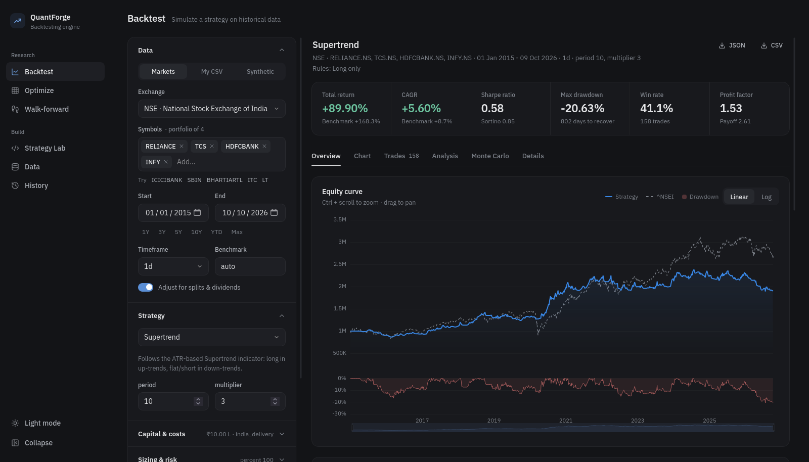

# QuantForge - Multi-Market Backtesting Engine

An event-driven backtesting engine with a web dashboard. You can test built-in strategies or your own Python code on **NSE, BSE, NASDAQ, NYSE, LSE, XETRA, Euronext, TSE, HKEX, TSX, ASX, crypto, forex and indices**, or on any OHLCV CSV file.



## Quick start

```bash
./start.sh
```

This installs the Python dependencies (with `uv`, or falls back to `venv` + `pip`), builds the dashboard the first time (requires Node.js 18+), and opens **http://localhost:8000**.

Manual equivalent:

```bash
uv sync
cd frontend && npm install && npm run build && cd ..
uv run python run.py            # --port 8000  --rebuild  --no-browser  --reload
```

Frontend development with hot reload: run `uv run python run.py --no-browser` and, in another terminal, `cd frontend && npm run dev` (http://localhost:5173 proxies `/api` to the backend).

Run the tests with `uv run --group dev pytest` (engine, trading rules and error reporting).

The end-to-end UI suite drives the real dashboard in Firefox:

```bash
uv run --group e2e python e2e/run_e2e.py
```

It runs 62 checks in about 10 minutes. It clicks every control, runs every built-in strategy and writes a new strategy in the Strategy Lab ([`e2e/strategies/squeeze_breakout.py`](e2e/strategies/squeeze_breakout.py)). It also optimises and walk-forward-tests that strategy, uploads a CSV, and covers the History and Data pages and phone width. It starts its own server on port 8765 with a throwaway data folder, so your history is untouched. The report and failure screenshots go to `e2e/output/`.

## Features

| Area | What you get |
|---|---|
| **Markets** | 14 exchange presets with ticker suffixes (`RELIANCE` → `RELIANCE.NS`), currency, default benchmark (Nifty 50, Sensex, NASDAQ Composite, S&P 500, FTSE…) and a matching cost model. Ticker search, an on-disk data cache, intraday intervals from 1m to 1h, and split/dividend adjustment. |
| **Your data** | Drag-and-drop CSV upload with automatic column detection (works with NSE bhavcopy, TradingView, MetaTrader, Binance and Yahoo exports). A synthetic regime-switching data generator for offline work. |
| **Engine** | Bar-by-bar, multi-asset simulation on a unified calendar. Market, limit, stop and stop-limit orders. Fills at the next bar's open (default) or the same bar's close, so there's no look-ahead. Bracket orders: stop-loss, take-profit, trailing stop and time exit, with realistic gap fills. Long/short, leverage, pyramiding, lot sizes, fractional quantities, a volume participation cap and margin-call liquidation. |
| **Costs** | Percent, flat or per-share fees; **Indian equity delivery, intraday and futures** (brokerage, STT, exchange charges, SEBI fee, stamp duty, GST); US equity (per-share fees plus SEC/FINRA); slippage. |
| **Sizing** | % of equity, fixed cash, fixed quantity, or risk-% per trade (sized from the stop distance). |
| **Trading rules** | Long/short-only, daily capital limits, daily square-off, entry time windows, trades-per-day and open-position caps, daily loss/profit stops, a drawdown kill switch, cooldowns and fixed vs compounding capital. They work with any strategy (see below). |
| **Strategies** | 16 built-ins: trend (SMA/EMA cross, MACD, Supertrend, ADX, time-series momentum), mean reversion (RSI, Bollinger, z-score, stochastic), breakout (Donchian/Turtle, Keltner), volatility targeting and portfolio rotation (cross-sectional momentum, equal-weight rebalance). |
| **Strategy Lab** | Write strategies in Python in the browser with syntax highlighting, validation that points at the error line, save, fork a built-in, and run. |
| **Analytics** | 50+ metrics: CAGR, Sharpe, Sortino, Calmar, Omega, max drawdown and its duration, Ulcer index, VaR/CVaR, alpha/beta, information ratio, profit factor, expectancy, SQN, Kelly, MAE/MFE and more. Equity vs benchmark, drawdown, monthly heatmap, annual bars, rolling Sharpe and volatility, return distribution, trade scatter, and candlestick charts with indicators and trade markers. |
| **Robustness** | Grid or random **parameter optimisation** across all CPU cores with a heatmap; **walk-forward analysis** (rolling or anchored) with walk-forward efficiency; **Monte Carlo** (block bootstrap of returns and trade resampling). |
| **Workflow** | Every run is saved: reopen, rename, star, or **compare** up to 8 runs. CSV/JSON export. Dark and light themes. Ctrl+Enter runs a backtest. |

## Trading rules

The **Trading rules** section in the settings panel applies constraints to *any* strategy, built-in or your own code. The rules also apply in optimisation and walk-forward runs. Leave a field empty to switch it off.

| Rule | Effect |
|---|---|
| Direction | Long only, both, or short only. In short-only mode, buy signals can only cover shorts. |
| Reinvest profits / fixed capital | Size trades from current equity (compounding), or always from the initial capital. |
| Max new capital per day | Caps the total value of positions opened per day, as an amount or as % of the day's starting equity. Larger orders are reduced. |
| Max position size | Per-symbol exposure cap, as % of equity. |
| Square off at end of day | Closes everything at the day's last bar, or at a set time for intraday data. On daily bars this means entering at the open and exiting at the close. Today's signals still enter at the next open. |
| Entry window | No new entries outside e.g. 09:30-14:30 (intraday data). |
| Max trades per day / max open positions | Entry fills beyond the limit are skipped. |
| Daily loss limit / daily profit target | Flatten and pause until the next day. |
| Drawdown kill switch | Flatten and stop trading for good at a given drawdown. |
| Cooldown after exit | Wait N bars before re-entering a symbol. |

Rules only ever block or shrink orders that *add* exposure; exits are always allowed. Each result lists the active rules, a **Rule activity** breakdown (squared-off days, skipped and reduced orders) and day-level statistics (profitable days, best and worst day).

## Writing a strategy

```python
class MyStrategy(Strategy):
    name = "RSI dip buyer"
    params = {"rsi_period": 14, "entry": 30, "exit": 55, "trend": 200}

    def init(self):                         # runs once, vectorised
        c = self.data.close
        self.rsi = self.I(rsi, c, self.p.rsi_period, name="RSI", overlay=False)
        self.trend = self.I(ema, c, self.p.trend, name="EMA 200")
        self.atr = self.I(atr, self.data.high, self.data.low, c, 14, plot=False)

    def next(self):                         # runs every bar, sees only the past
        price = self.data.close[-1]
        if self.position.is_flat and price > self.trend[-1] and self.rsi[-1] < self.p.entry:
            self.buy(sl=price - 2 * self.atr[-1], tag="dip")
        elif self.position.is_long and self.rsi[-1] > self.p.exit:
            self.close()
```

* **Data:** `self.data.open/high/low/close/volume[-1]` gives the latest bar; `[-2]` the one before. `self.data.df` is a pandas frame up to now, `self.datas[sym]` holds the other symbols, and `self.data.time` is the current timestamp.
* **Indicators:** `sma ema wma hma rsi macd bollinger atr stochastic adx supertrend donchian keltner vwap obv roc momentum cci williams_r zscore stddev highest lowest`, plus `crossover(a, b)` and `crossunder(a, b)`. Wrap any of them, or any array, in `self.I(...)` and it is plotted automatically.
* **Orders:**
  * `self.buy(size=None, sl=, tp=, trail=, limit=, stop=)` and `self.sell(...)`.
  * `self.close()`, `self.order_target_percent(w)`, `self.order_target_qty(q)`, `self.set_stops(sl=, tp=)`.
  * `size=None` uses the sizing rule, a value in `(0, 1]` is a fraction of equity, and `> 1` is a number of units.
* **State:** `self.position` (`is_long`, `is_short`, `qty`, `avg_price`, `pnl_pct`, `bars_held`), `self.equity`, `self.cash`, `self.p.<param>` and `self.log(...)`.
* **Portfolio strategies:** set `per_asset = False` to get one instance that trades the whole universe through `self.datas`.

## Architecture

```
backend/
  engine/
    core.py        event-driven Backtester, Broker, orders, positions, brackets
    strategy.py    Strategy base class, look-ahead-safe Line/DataView
    indicators.py  causal technical indicators
    data.py        Yahoo / CSV / synthetic loaders, normalisation, cache
    markets.py     exchange registry (suffix, currency, benchmark, costs)
    costs.py       commission models (incl. Indian statutory charges)
    metrics.py     performance & risk analytics
    montecarlo.py  bootstrap simulations
    optimize.py    grid/random search (multiprocess) + walk-forward
    library.py     built-in strategies
    sandbox.py     loader for user strategy code
    runner.py      request → data → backtest → JSON
  api/
    main.py        FastAPI REST API + static dashboard
    store.py       SQLite run history, saved strategies
frontend/          React + TypeScript + Vite, ECharts, TradingView Lightweight Charts, CodeMirror
data_store/        cache, uploads, saved strategies, runs.db (created at runtime)
```

## Security note

Custom strategies are ordinary Python that runs on your machine. The sandbox limits imports and removes dangerous builtins, but **it is not a security boundary**. For that reason the server binds to `127.0.0.1`, rejects foreign `Host` headers (which blocks DNS rebinding), and blocks cross-origin writes. Don't expose it on a network you don't trust.

## Data caveats

Yahoo Finance data is free but imperfect. Some tickers have short or broken histories (for example, a few `.BO` symbols return only the latest bar; the engine flags these). Survivorship bias also applies to today's index members. For serious research, upload vetted data as CSV.
